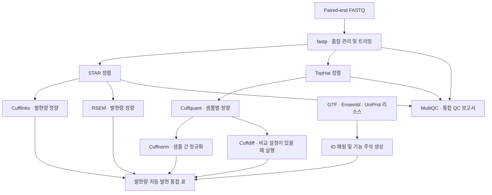

# atgcu-rnaseq

| 작성일 | 작성자 |
| --- | --- |
| 2026-10-16 | 유승일 |

**Paired-end bulk RNA-seq 데이터를 분석하는 Snakemake 파이프라인입니다.** FASTQ 품질 관리부터 유전체 정렬, 유전자·전사체 발현량 정량, 차등 발현 분석, 기능 주석 및 결과 표 생성까지 연결합니다.

STAR와 TopHat을 함께 실행하며, 각 정렬 결과를 서로 다른 발현 분석 도구에 전달합니다. 실행 대상은 [workflow/Snakefile](workflow/Snakefile), 결과 파일 목록은 [FinalTarget](workflow/rules/common.smk)에서 관리합니다.

## 분석 흐름



**Cufflinks는 STAR의 좌표 정렬 BAM을 사용하고, Cuffquant는 TopHat의 BAM을 사용합니다.** 따라서 Cufflinks 결과와 Cuffnorm·Cuffdiff 결과는 정렬 입력부터 다릅니다. RSEM에는 STAR의 transcriptome BAM을 전달합니다.

### 기본 실행 범위

| 단계 | 도구 또는 처리 | 기본 실행 동작 |
| --- | --- | --- |
| 리소스 준비 | GTF, Ensembl, UniProt 파싱 | 유전자–전사체 매핑, 설명, GO·InterPro·Pfam 주석 생성 |
| 읽기 품질 관리 | fastp | Paired-end 트리밍, HTML·JSON QC 결과 생성 |
| 정렬 | STAR, TopHat | 두 정렬 경로 모두 실행 |
| 발현량 정량 | Cufflinks, Cuffquant, Cuffnorm, RSEM | 유전자·전사체 수준 정량 및 결과 표 생성 |
| 차등 발현 | Cuffdiff | `config/compare.yml`에 등록된 비교별 실행 |
| 결과 정리 | `parser.py`, MultiQC | QC·발현량·DEG 표와 통합 QC HTML 생성 |
| 추가 경로 | HISAT2, Arriba | 규칙은 포함되어 있으나 기본 최종 대상에서 제외 |
| 별도 HTML 보고서 | `report.Rmd` | 기본 최종 대상에서 제외되어 있으며 현재 내용은 템플릿 |

비교 설정이 비어 있으면 Cuffdiff 분석 작업은 생성되지 않습니다. 다만 DEG 표를 만드는 `parse_cuffdiff`는 기본 최종 대상에 남아 있으며, 기존 `anl/cuffdiff/` 디렉터리의 결과를 검색합니다.

## 저장소 구조

| 경로 | 역할 |
| --- | --- |
| [config.py](config.py) | CSV 메타데이터와 FASTQ 파일명을 읽어 샘플·비교 YAML 생성 |
| [meta/](meta/) | 샘플 그룹과 대조군·처리군 비교를 정의하는 CSV |
| [config/](config/) | 설정 파일 경로, 참조 리소스, 분석 파라미터, 샘플, 비교 정의 |
| [workflow/Snakefile](workflow/Snakefile) | 설정 로딩, 최종 대상 지정, 분석 규칙 연결 |
| [workflow/rules/common.smk](workflow/rules/common.smk) | `ConfigSetUp`, `FinalTarget`, 입력 경로 보조 함수 |
| [workflow/rules/](workflow/rules/) | 도구 실행, 인덱스 생성, 결과 파싱 규칙 |
| [workflow/scripts/parser.py](workflow/scripts/parser.py) | 참조 주석 생성과 QC·발현량·차등 발현 결과 통합 |
| [workflow/envs/](workflow/envs/) | 개별 도구용 Conda 환경 정의 |
| [environment.yml](environment.yml) | Snakemake 실행용 기본 Conda 환경 정의 |
| [.github/workflows/](.github/workflows/) | 포맷 검사, lint, 워크플로 테스트 및 릴리스 자동화 설정 |

## 설정과 입력 데이터

### 설정 파일의 역할

진입 설정은 [config/config.yml](config/config.yml)입니다. `ConfigSetUp`이 아래 설정을 읽어 하나의 실행 설정으로 구성합니다.

| 파일 | 주요 설정 | 설명 |
| --- | --- | --- |
| `config/config.yml` | `ref_id`, `conf_ref`, `conf_param`, `conf_sample`, `conf_compare` | 사용할 참조와 하위 설정 파일 선택 |
| `config/ref.yml` | FASTA, GTF, Ensembl·UniProt 파일, 인덱스·주석 경로 | 참조 리소스 정의 |
| `config/param.yml` | fastp 어댑터 설정, STAR 옵션, DEG 임계값 | 분석 파라미터 정의 |
| `config/sample.yml` | `fastq_1`, `fastq_2`, `cuff_librarytype`, `group` | 샘플별 입력과 그룹 정의 |
| `config/compare.yml` | `control`, `treatment` | 비교별 그룹명과 샘플 목록 정의 |

`ref.yml`에는 사람, 말, 생쥐, 애기장대 참조 항목이 있습니다. 항목이 존재한다는 사실만으로 각 참조의 실행 성공이 보장되지는 않습니다.

### 메타데이터 작성

샘플 CSV는 `sample,group`, 비교 CSV는 `compid,control,case` 헤더를 사용합니다. 다음은 형식을 설명하기 위한 예시입니다.

`meta/sample_meta.csv`:

```csv
sample,group
Sample01,Control
Sample02,Treatment
```

`meta/compare_meta.csv`:

```csv
compid,control,case
Treatment_vs_Control,Control,Treatment
```

`case` 그룹은 생성된 비교 YAML의 `treatment`에 대응합니다. 그룹명은 샘플 메타데이터와 정확히 일치해야 합니다.

`config.py`는 지정 디렉터리 바로 아래의 `*.fastq.gz`를 검색합니다. 인식하는 파일명은 다음과 같습니다.

| Read | 지원하는 파일명 |
| --- | --- |
| R1 | `<sample>_R1.fastq.gz`, `<sample>_1.fastq.gz` |
| R2 | `<sample>_R2.fastq.gz`, `<sample>_2.fastq.gz` |

샘플 설정 생성 시 `cuff_librarytype`의 기본값은 `fr-unstranded`입니다. 실제 라이브러리 조건에 맞게 확인해야 합니다. FASTQ 누락을 확실히 차단하는 검증이 없으므로, 생성 후 모든 샘플의 두 입력 경로를 확인하세요.

## 실행 준비와 명령 예시

아래 명령은 저장소 루트에서 사용하는 예시입니다. 이 문서를 작성한 환경에서는 실제로 실행 검증하지 않았습니다.

### 1. 환경 및 참조 경로 준비

기본 환경에는 Snakemake `7.32.3`과 Python `3.11.5`가 명시되어 있습니다. 개별 도구는 규칙의 Conda 환경 또는 Snakemake wrapper로 연결됩니다.

- 환경 YAML에는 Linux 전용 빌드와 일부 서버 절대 경로인 `prefix`가 포함되어 있습니다. 실행 서버에 맞게 확인하세요.
- `parser.py`는 Biopython의 `Bio`를 import하지만, 기본 `environment.yml`에는 Biopython이 명시되어 있지 않습니다. 파서 실행 환경에 해당 의존성을 준비해야 합니다.
- `config/ref.yml`의 FASTA·GTF·Ensembl·UniProt 경로와 샘플 FASTQ 경로를 실제 서버 경로에 맞게 설정하세요. 원본 데이터는 저장소에 포함되어 있지 않습니다.
- 일부 wrapper가 `master`를 참조하므로 실행 시 가져오는 wrapper 버전은 고정되어 있지 않습니다.

환경 정의를 실행 서버에 맞게 정리한 뒤 생성·활성화하는 예시입니다.

```bash
conda env create --file environment.yml
conda activate snakemake
```

### 2. 샘플·비교 설정 생성

CSV 메타데이터와 FASTQ 디렉터리를 준비한 뒤 실행합니다. **이 명령은 `config/sample.yml`과 `config/compare.yml`을 덮어씁니다.**

```bash
python config.py \
  --fastq-dir readyfastq \
  --config-dir config \
  --sample-meta meta/sample_meta.csv \
  --compare-meta meta/compare_meta.csv
```

### 3. 실행 계획 확인 및 분석

먼저 dry-run으로 입력 경로와 작업 구성을 확인합니다.

```bash
snakemake --snakefile workflow/Snakefile --dry-run --printshellcmds
```

현재 일부 파서 규칙은 사용하는 주석 파일을 `input`에 선언하지 않습니다. 최초 실행에서는 주석 생성 작업을 먼저 완료한 뒤 전체 분석을 실행하는 순서로 이 의존성 누락을 보완할 수 있습니다.

```bash
snakemake --snakefile workflow/Snakefile --use-conda --cores 8 \
  get_anno_uniprot get_mapg2t_gtf get_desc

snakemake --snakefile workflow/Snakefile --use-conda --cores 8
```

`--cores 8`은 명령 예시이며, 필요한 CPU·메모리·디스크 용량을 검증한 값은 아닙니다. 실제 실행 자원은 샘플 규모와 서버 환경에 맞게 결정해야 합니다.

## 주요 출력물

| 경로 | 내용 |
| --- | --- |
| `src/` | 정렬·정량 인덱스, 유전자–전사체 매핑 및 주석 TSV |
| `anl/fastp/<sample>/` | 트리밍된 FASTQ, 샘플별 QC HTML·JSON |
| `anl/star/<sample>/` | 유전체·전사체 BAM, BAM 인덱스, 유전자 카운트, 정렬 로그 등 |
| `anl/tophat/<sample>/` | `accepted_hits.bam`, 정렬 요약 |
| `anl/cufflinks/<sample>/` | 유전자·전사체 FPKM tracking 파일 |
| `anl/cuffquant/<sample>/` | `abundances.cxb` |
| `anl/cuffnorm/` | 유전자·전사체 FPKM table |
| `anl/cuffdiff/<compare>/` | 비교별 `gene_exp.diff`, `isoform_exp.diff` |
| `anl/rsem/<sample>/` | 유전자·전사체 정량 원본 결과 |
| `anl/table/` | 시퀀싱·정렬 통계, 발현량 행렬, 발현 통계, DEG 통합 표 |
| `anl/multiqc/multiqc_report.html` | fastp·STAR·TopHat 결과를 모은 QC 보고서 |
| `logs/`, `benchmarks/` | 규칙에 정의된 실행 로그 및 자원 사용 기록 |

**`anl/table/`의 `.xls` 파일은 Excel 바이너리 문서가 아닌 탭 구분 텍스트입니다.** 다른 프로그램에서 읽을 때 TSV 형식으로 처리해야 합니다.

### 결과 해석에 필요한 구현 사항

| 항목 | 현재 구현 |
| --- | --- |
| 발현량 표 | Cufflinks·Cuffnorm은 FPKM, RSEM은 FPKM·TPM·read count·length 등을 내보냄 |
| 발현 필터 | `*.fpkm.exp.xls`는 샘플 중 하나 이상에서 FPKM ≥ 0.3인 항목을 포함 |
| 발현 통계 | FPKM ≥ 0.3, 1, 10, 100, 1000 기준으로 단백질 코딩 항목 수를 집계 |
| RSEM read count | 원본 `expected_count`를 반올림해 정수로 내보냄. 원본 결과 파일과 값의 표현이 다를 수 있음 |
| DEG fold change | Cuffdiff의 fold change 열을 그대로 쓰지 않고 `log2(case FPKM + 1) − log2(control FPKM + 1)`로 재계산 |
| DEG 기본 기준 | 재계산한 `abs(Log2FC) ≥ 0.584` 및 `p < 0.05`. 현재 `q_criteria: 1`은 q-value 필터 비활성화를 뜻함 |

세부 구현은 [parser.py](workflow/scripts/parser.py), 임계값은 [param.yml](config/param.yml)에서 확인할 수 있습니다. 위 기준은 코드의 동작을 설명하며, 특정 연구에 적합한 분석 기준을 검증한 것은 아닙니다.

## 확인된 제약과 유지보수 지점

| 항목 | 코드에서 확인한 내용 | 영향 |
| --- | --- | --- |
| 주석 파일 의존성 | 발현량·DEG 파서가 읽는 주석 파일이 일부 규칙의 `input`에서 누락 | 최초 병렬 실행의 순서가 보장되지 않고, 주석 변경 시 자동 재실행이 누락될 수 있음 |
| 결과 검색 범위 | Cufflinks·Cuffdiff 파서가 결과 디렉터리 내부 파일을 직접 검색 | 작업 디렉터리를 재사용하면 이전 샘플·비교 결과가 포함될 수 있음 |
| fastp 어댑터 설정 | `param.yml`의 `fastp.adapters`를 실행 규칙의 `params`에 전달하는 연결이 없음. 로컬 `scripts/fastp.py`도 현재 규칙에서 사용하지 않음 | 설정에 적힌 어댑터가 실제 실행에 적용된다고 볼 수 없음 |
| 실행 환경 재현성 | Linux 빌드 고정, 서버 절대 경로, 일부 `master` wrapper 참조 | 다른 환경에서 경로·의존성·wrapper 호환성 확인 필요 |
| CI 테스트 | `.github/workflows/main.yml`이 `.test`를 참조하지만 해당 디렉터리는 저장소에 없음 | 현재 CI 설정만으로 전체 실행 검증을 기대하기 어려움 |
| 별도 보고서 | `report.Rmd`가 템플릿이며 기본 대상에서도 제외 | MultiQC 외의 완성된 분석 보고서가 자동 생성된다고 볼 수 없음 |
